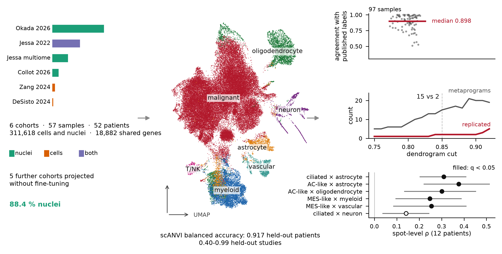
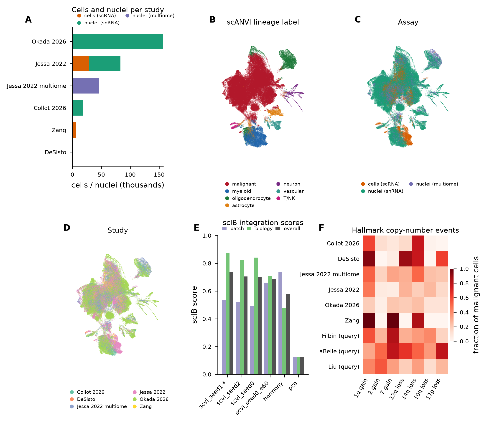
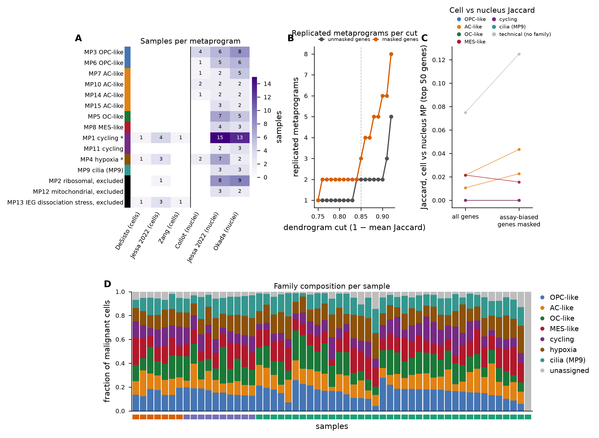
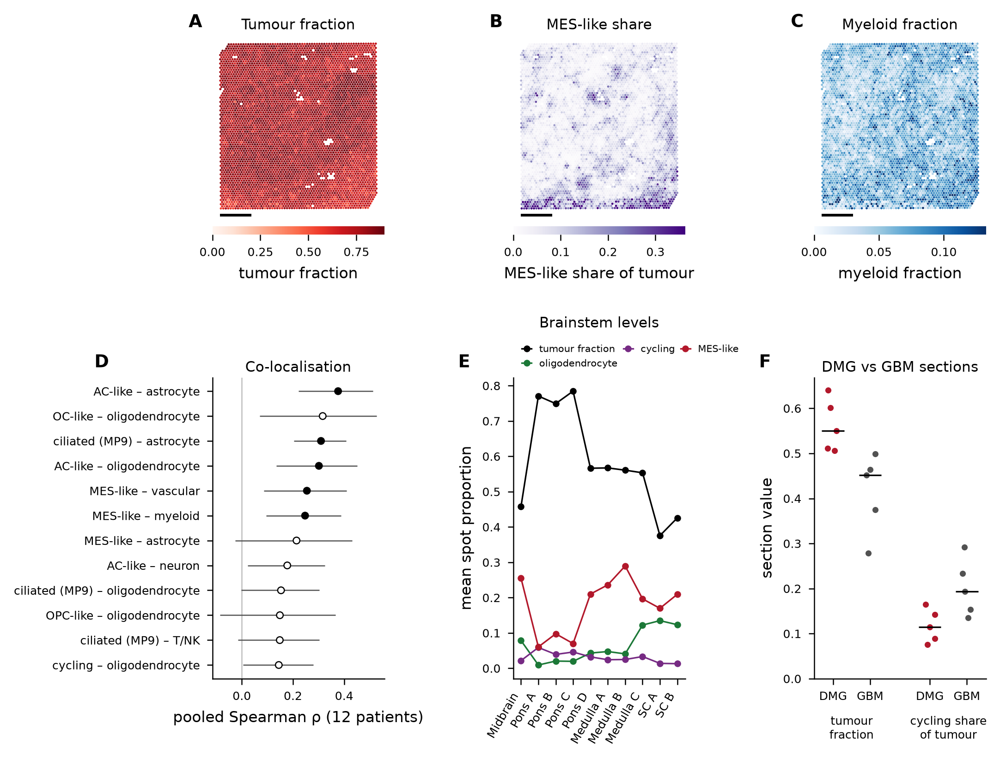
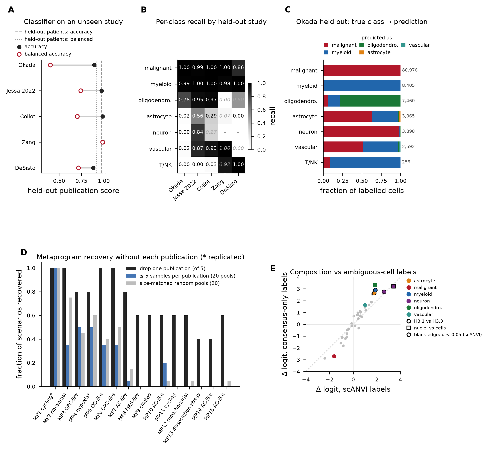

# DMG Atlas: A cross-cohort single-cell reference atlas of H3K27-altered diffuse midline glioma

<div align="center">

</div>

**The reference.** 311,618 cells and nuclei from 57 samples and 52 patients across six public cohorts, integrated with
scVI/scANVI and coloured by scANVI lineage label. Lineage compartments separate and studies intermix within them, but
mixing across assays remains incomplete (assay iLISI 0.029).

Public single-cell, single-nucleus and multiome RNA-seq cohorts of human DMG are integrated into a **scVI/scANVI
reference**. Smart-seq2/TPM tumour cohorts and normal brain references are projected onto it as queries, Visium
sections are deconvolved with **cell2location**, and malignant cell states are characterised by per-sample
**consensus NMF**. Human data only.

**What you can do with it:** look up any cell's lineage, malignancy call, CNV events and metaprogram state across six
cohorts; compare malignant states between cells and nuclei; and project your own DMG (or normal brain) single-cell data
onto the reference to get lineage predictions in a shared latent space, without retraining
([Using the atlas](#using-the-atlas)).

## Contents

[At a glance](#at-a-glance) · [Key figures](#key-figures) · [Cohorts](#cohorts) · [Main results](#main-results) ·
[Quality checks](#quality-checks) · [Using the atlas](#using-the-atlas) · [Reproducing the pipeline](#reproducing-the-pipeline) ·
[Repository layout](#repository-layout) · [Data release](#data-release) · [Limitations](#limitations) ·
[Documentation](#documentation) · [Citation](#citation) · [License](#license)

## At a glance

| | |
|---|---|
| **Reference** | 311,618 cells / nuclei · 57 samples · 52 patients · 6 studies |
| **Assays** | 229,043 snRNA · 46,288 multiome RNA · 36,287 scRNA |
| **Queries** (projection only) | Filbin 2018, LaBelle 2025, Liu 2022 (tumour) · Braun 2023 fetal hindbrain, Siletti 2023 adult pons (normal) |
| **Spatial** | 27 Visium sections from 4 cohorts |
| **Release** | `dmg_atlas_v1.h5ad` · 18,865 GENCODE v48 genes · CELLxGENE schema 7.1.0 layout |


<table>
<tr>
<td width="50%"></td>
<td width="50%"></td>
</tr>
<tr>
<td><b>Fig. 1 · Integrated reference.</b> Cells per study and assay (A); UMAP by scANVI lineage, assay and study (B–D);
scIB benchmark of scVI seeds against Harmony and PCA (E); hallmark copy-number events per cohort (F).</td>
<td><b>Fig. 3 · Malignant metaprograms.</b> Samples contributing to each of 15 metaprograms, split by cells and nuclei
(A; * = replicated); replication across dendrogram cuts with and without assay-biased genes (B); cell–nucleus overlap
(C); metaprogram-family composition of malignant cells per sample (D).</td>
</tr>
<tr>
<td></td>
<td></td>
</tr>
<tr>
<td><b>Fig. 5 · Spatial organisation.</b> cell2location maps of tumour fraction, MES-like share and myeloid fraction on
one Visium section (A–C); pooled co-localisation over 12 patients (D, filled = q &lt; 0.05); brainstem levels (E); DMG
vs GBM sections (F).</td>
<td><b>Fig. 7 · Robustness.</b> Reference classifier on held-out studies, metaprogram recovery without each publication,
and sensitivity of composition effects to label choice.</td>
</tr>
</table>

All main (1–7) and supplementary (S1–S8) figures: [`results/pub_figs/`](results/pub_figs); list in
[Main results](#main-results).

## Cohorts

| Study | Role | Samples | Patients | Cells | Assay | Data URL |
|---|---|---:|---:|---:|---|---|
| Okada | reference | 22 | 22 | 156,936 | snRNA | [UCSC Cell Browser](https://cells-test.gi.ucsc.edu/brain-dmg-multiomics/) · raw: [EGAS50000001447](https://ega-archive.org/studies/EGAS50000001447) (controlled) |
| Jessa 2022 (scRNA/snRNA) | reference | 17 | 17 | 83,076 | snRNA, scRNA | [GSE210567](https://www.ncbi.nlm.nih.gov/geo/query/acc.cgi?acc=GSE210567) |
| Jessa 2022 (multiome) | reference | 10 | 10 | 46,288 | multiome RNA | [GSE210566](https://www.ncbi.nlm.nih.gov/geo/query/acc.cgi?acc=GSE210566) |
| Collot | reference | 5 | 4 | 17,562 | snRNA | [Zenodo 17922773](https://doi.org/10.5281/zenodo.17922773) |
| Zang | reference | 1 | 1 | 6,546 | scRNA | [GSE245674](https://www.ncbi.nlm.nih.gov/geo/query/acc.cgi?acc=GSE245674) (GSM7846769) |
| De Sisto | reference | 2 | 2 | 1,210 | scRNA | [GSE231859](https://www.ncbi.nlm.nih.gov/geo/query/acc.cgi?acc=GSE231859) |
| Liu 2022 | query | 42 | 41 | 12,438 | Smart-seq2 | [GSE184357](https://www.ncbi.nlm.nih.gov/geo/query/acc.cgi?acc=GSE184357) |
| LaBelle 2025 | query | 9 | 9 | 8,247 | scRNA, Smart-seq2 | [GSE227983](https://www.ncbi.nlm.nih.gov/geo/query/acc.cgi?acc=GSE227983), [GSE271936](https://www.ncbi.nlm.nih.gov/geo/query/acc.cgi?acc=GSE271936) |
| Filbin 2018 | query | 9 | 9 | 3,037 | Smart-seq2 | [GSE102130](https://www.ncbi.nlm.nih.gov/geo/query/acc.cgi?acc=GSE102130) |
| Braun 2023 hindbrain | normal query | 17 | 17 | 100,000 | scRNA | [CELLxGENE collection](https://cellxgene.cziscience.com/collections/4d8fed08-2d6d-4692-b5ea-464f1d072077) |
| Siletti 2023 pons | normal query | 18 | 3 | 100,000 | snRNA | [CELLxGENE collection](https://cellxgene.cziscience.com/collections/283d65eb-dd53-496d-adb7-7570c7caa443) |

Exact file URLs, sha256 checksums and download dates are written by the fetch scripts to `data/raw/MANIFEST_tumour.csv`
and `data/raw/MANIFEST_spatial_refs.csv` (local, not tracked).
Per-study summary (site, H3 variant, age group, malignant fractions): `results/tables/atlas_v1_summary.csv`.
Per-sample metadata: `data/processed/sample_manifest.csv`.

## Main results

| Finding | Result |
|---|---|
| **Metaprograms** | Per-sample cNMF on 50 samples (46 patients) gives 15 metaprograms; **2 replicate** under the pre-registered rule (≥ 3 studies, cells and nuclei): MP1 cycling and MP4 hypoxia |
| **Spatial** | MES-like × myeloid co-localisation supported (ρ = 0.247, 95 % CI 0.096–0.388, q = 0.016); OPC-like × oligodendrocyte not (ρ = 0.149, q = 0.402); associations vary between sections and are tentative |
| **Malignant calling** | Consensus calls agree with author labels at a per-sample median of 0.898 over 97 labelled samples |
| **Reference classifier** | 0.975 accuracy, 0.917 balanced accuracy on held-out patients; on a held-out *study*, balanced accuracy falls to 0.40–0.99 ([quality checks](#quality-checks)) |

<details>
<summary><b>Figures</b> (generated from tables by <code>scripts/30_figures.py</code> and <code>scripts/31_supp_figures.py</code>)</summary>

| Figure | Content |
|---|---|
| 1 | Integrated reference: composition, scANVI lineage labels, scIB benchmark, hallmark CNV events |
| 2 | Zero-shot projection of query cohorts and label transfer |
| 3 | Malignant metaprograms and the pre-registered replication test |
| 4 | Microenvironment subclusters and sample-level composition models |
| 5 | Spatial organisation of malignant states (cell2location) |
| 6 | ATAC, bulk survival and foundation-model anchoring (*exploratory*) |
| 7 | Robustness: classifier on held-out studies, metaprogram recovery, composition label sensitivity (`scripts/36_fig_robustness.py`; Figure 6 of the preprint) |
| S1–S8 | Malignant calls, integration benchmark, mapping confidence, metaprogram robustness, assay masking, TME markers, spatial niches, survival models |

Output: `results/pub_figs/main`, `results/pub_figs/supp`. Captions with input md5s: `docs/figures/figures.md`,
`docs/figures/supp_figures.md`.

</details>

## Quality checks

Robustness analyses run after release (Phase 9; outputs in `results/tables/quality/`, details in
[`docs/phases/phase9_quality_notes.md`](docs/phases/phase9_quality_notes.md)).

| Check | Script | Result |
|---|---|---|
| Classifier on an unseen **publication** (scVI + scANVI refitted without it, scArches mapping) | `32_loso_classifier` | accuracy 0.88–0.99 per held-out study, but balanced accuracy 0.40–0.99 (pooled 0.51 vs 0.92 on held-out patients); malignant and myeloid transfer, rare normal lineages do not; with Okada unseen, 98 % of its neurons are called malignant |
| Metaprograms without each publication, and with ≤ 5 samples per publication | `33_metaprogram_lopo` | MP1 cycling recovered in every scenario; MP4 hypoxia needs Jessa 2022; MES-like and novel MP9 need both Jessa 2022 and Okada |
| Cell-type composition with consensus-only labels for the 29 % ambiguous cells | `34_composition_label_sensitivity` | all 4 significant effects keep sign and q < 0.05 |

## Using the atlas

No pipeline run is needed to use the atlas: download the release from Zenodo and load it with `anndata`/`scanpy`.

### 1. Download

From [doi:10.5281/zenodo.23623335](https://doi.org/10.5281/zenodo.23623335):

| Path in deposit | Size | Use it for |
|---|---:|---|
| `data/dmg_atlas_v1.h5ad` | 1.6 GB | the reference: raw counts, all labels, embeddings |
| `data/query_mapping.h5ad` | 0.5 GB | the 5 projected query cohorts with predictions and uncertainty |
| `data/malignant_calls.csv.gz` | 48 MB | per-cell malignancy tiers (author / own CNV / consensus) |
| `data/sample_manifest.csv` | 0.1 MB | per-sample metadata (site, H3 variant, age, assay) |
| `models/scanvi_reference/`, `models/scvi_reference/` | 28 MB | reference weights for mapping new data (scvi-tools 1.4.2) |
| `metadata/obs_columns.csv`, `metadata/label_ontology.csv` | — | data dictionary and label vocabulary |

Check downloads with `md5sum -c MD5SUMS`. Python ≥ 3.10 with `anndata ≥ 0.10` and `scanpy` is enough for steps 2–3;
step 4 needs `scvi-tools==1.4.2`.

### 2. Explore the reference

```python
import anndata as ad
import scanpy as sc

atlas = ad.read_h5ad("data/dmg_atlas_v1.h5ad", backed="r")   # backed: obs/obsm in memory, counts on disk
atlas.obs[["study", "sample_id", "donor_id", "assay_atlas", "cell_type_atlas", "malignant_call", "mp_family"]]

# UMAP coloured by lineage (precomputed embedding; no counts loaded)
sc.pl.embedding(atlas, basis="X_umap", color=["cell_type_atlas", "study"], frameon=False)

# load counts for a subset only, e.g. one study, then normalise
sub = atlas[atlas.obs["study"] == "collot"].to_memory()
sub.var_names = sub.var["gene_symbol"].astype(str); sub.var_names_make_unique()
sc.pp.normalize_total(sub, target_sum=1e4); sc.pp.log1p(sub)
sc.pl.embedding(sub, basis="X_umap", color=["OLIG2", "PDGFRA", "CD74"])
```

Key fields (all 199 are listed in `metadata/obs_columns.csv` and [`docs/release/release_v1.md`](docs/release/release_v1.md)):

| Field | Meaning |
|---|---|
| `X` | raw UMI counts (float32 CSR); `var_names` are Ensembl IDs, gene symbols in `var['gene_symbol']` |
| `obsm['X_scanvi']`, `obsm['X_scvi']`, `obsm['X_umap']` | 30-d scANVI / scVI latents and the UMAP built on `X_scanvi` |
| `obsm['X_scvi_malignant']` | malignant-only scVI latent (NaN outside the malignant subset) |
| `cell_type_atlas` / `cell_type_ontology_term_id` | final cell label (cleaned TME subcluster, else scANVI lineage) and its CL term |
| `scanvi_label`, `scanvi_maxprob` | scANVI lineage prediction and its confidence |
| `malignant_call`, `consensus_call`, `cnv_call` | three-tier malignancy calls; `chr1q_gain`, `chr7_gain`, `chr10q_loss`, … are per-cell CNV events |
| `mp_family`, `mp_top`, `mp_z_MP1` … `mp_z_MP15` | malignant metaprogram family (`OPC_like`, `AC_like`, `OC_like`, `MES_like`, `cycling`, `hypoxia`, `novel_MP9`; `unassigned` / `not_selected` otherwise) and z-scores |
| `tme_compartment`, `tme_annotation` | microenvironment subclusters (e.g. `hypoxic_glycolytic_TAM`, `interferon_TAM`) |
| `author_*` | original author annotations, copied verbatim |

### 3. Common analyses

```python
obs = atlas.obs

# malignant cells as defined for state analysis (Methods)
mal = (obs["consensus_call"] == "malignant") | ((obs["scanvi_label"] == "malignant") & (obs["scanvi_maxprob"] >= 0.9))

# metaprogram-family composition per sample
comp = (obs[obs["malignant_selected"]].groupby("sample_id", observed=True)["mp_family"]
        .value_counts(normalize=True).unstack(fill_value=0))

# cells vs nuclei: compare families by suspension type
obs[obs["malignant_selected"]].groupby("suspension_type", observed=True)["mp_family"].value_counts(normalize=True)

# query cohorts: predicted lineage and uncertainty in the shared latent space
q = ad.read_h5ad("data/query_mapping.h5ad")
q.obs.groupby("query", observed=True)["predicted_lineage"].value_counts(normalize=True)
confident = q[(q.obs["scanvi_maxprob"] >= 0.9) & q.obs["classifier_knn_agree"].astype(bool)]
```

Use `malignant_call` (consensus-gated) rather than `scanvi_label` alone when counting tumour cells, and treat
`mp_family == "unassigned"` and `"not_selected"` as missing, not as a state.

### 4. Map your own data onto the reference

The scANVI reference maps new data **zero-shot**: its encoder ignores batch covariates, so a query is encoded with the
reference weights unchanged, with no training. This is how the five query cohorts were mapped
([`scripts/11g_remap_queries_zeroshot.py`](scripts/11g_remap_queries_zeroshot.py)).

```python
import anndata as ad
from scvi.model import SCANVI           # scvi-tools 1.4.2

REF = "models/scanvi_reference"          # from the Zenodo deposit (model.pt + var_names.txt)
query = ad.read_h5ad("my_dmg_sample.h5ad")   # raw counts, gene SYMBOLS as var_names (GRCh38 / 10x naming)

query.layers["counts"] = query.X.copy()       # model reads raw counts from layers['counts']
query.obs["sample_id"] = "my_sample"          # registry fields the model expects; values may be new
query.obs["study"] = "my_study"
query.obs["assay"] = "snRNA"                  # 'scRNA', 'snRNA' or 'multiome_RNA'
query.obs["pct_mito"] = 100 * query[:, query.var_names.str.startswith("MT-")].X.sum(1).A1 / query.X.sum(1).A1
query.obs["lineage_label"] = "Unknown"

SCANVI.prepare_query_anndata(query, REF)      # reorders to the 3,000 reference genes, zero-fills missing ones
model = SCANVI.load_query_data(query, REF)
model.is_trained = True                       # zero-shot: keep reference weights, do not call model.train()

query.obsm["X_scanvi"] = model.get_latent_representation()
probs = model.predict(soft=True)
query.obs["predicted_lineage"] = probs.idxmax(axis=1).values
query.obs["scanvi_maxprob"] = probs.max(axis=1).values
```

Run on 2,000 randomly drawn reference cells, this snippet reproduces the released `scanvi_label` for every cell. Predictions
are lineage-level (`malignant`, `myeloid`, `oligodendrocyte`, `astrocyte`, `neuron`, `vascular`, `T_NK`). Keep
`scanvi_maxprob ≥ 0.9` as a confidence filter, and confirm malignancy with CNV inference: normal progenitors without a
reference counterpart are called malignant (see [Limitations](#limitations)). For a joint UMAP, concatenate
`query.obsm['X_scanvi']` with `atlas.obsm['X_scanvi']` and run `sc.pp.neighbors(use_rep="X_scanvi")` + `sc.tl.umap`.

### 5. Browse without code

A CELLxGENE Discover deposit (log-normalised `X` plus raw counts) is built by
[`scripts/46_cellxgene_deposit.py`](scripts/46_cellxgene_deposit.py); the link will be added here once it is public.

## Reproducing the pipeline

```bash
# environment (local: Python 3.11.16, scanpy 1.11.5, scvi-tools 1.4.2, anndata 0.12.19)
conda create -n dmg_atlas --file env/local_conda_list.txt
conda activate dmg_atlas
pip install -r env/local_pip_freeze.txt

# run any step from the repo root (each script documents its usage in its docstring)
nice -n 10 python scripts/03_ingest_qc.py --study jessa_scrna
```

- Scripts add `src/` to `sys.path` themselves; no package install needed.
- Completed steps are skipped unless `--force` is given.
- Runs on a 24 GB laptop with 8 threads (`DMG_ATLAS_THREADS`). scVI/scANVI training and cell2location run on a Modal
  A10G GPU (`modal/`).
- Pinned versions, local and Modal: `env/versions.csv`, `env/environment.md`.

<details>
<summary><b>Full run order</b></summary>

Stage numbers follow the scripts and logs; they differ from `docs/design/build_plan.md`.

| Stage | Scripts |
|---|---|
| 1. Acquisition | `01_fetch_tumour_geo`, `01c_fetch_nongeo`, `01b_build_label_tables`, `01d_reference_gene_sets`, `02_build_sample_manifest`, `03_subset_braun_hindbrain`, `02_qc_spatial_sections` |
| 2. QC | `03_ingest_qc` (per study; batch: `bash scripts/run_phase2_all.sh`), `04_qc_report` |
| 3. CNV / malignant calls | `05_cnv_calls` (per study), `06_cnv_aggregate`, `06b_tier3_composition_fix` |
| 4. Reference integration | `07_assemble_atlas_input`, `07b_make_training_files`, `07c`, `07d`, Modal `phase4_train.py` + `phase4b_scanvi_retrain.py`, `08_integration_metrics`, `09_assemble_atlas_core`, `09b_refresh_atlas_core` |
| 5. Query mapping | `10_prepare_queries`, `11g_remap_queries_zeroshot`, `11b`–`11f`, `12_package_v1` |
| 6. States and spatial | `13_cnmf_per_sample`, `16_metaprograms`, `19_metaprogram_scores`, `20_assay_masked_metaprograms`, `13a`, `13b`, `14b_prepare_visium_fix` → Modal `phase6_c2l.py` → `14c_collect_fix`, `15b_spatial_tests_fix`, `15c_spatial_figures_fix`, `17`, `22`, `18_composition`, `23_package_phase6` |
| 7. Multimodal and bulk (exploratory) | `24_atac_multiome`, `25_openpedcan_survival`, `25b_survival_rankscore_audit`, `26_foundation_embeddings`, `26b_foundation_comparison_rebuild` |
| 8. Release and figures | `27_package_release`, `28_record_environment`, `29_validate_release`, `30_figures`, `31_supp_figures` |
| 9. Quality checks, deposit, preprint | Modal `phase9_loso_scanvi.py` → `32_loso_classifier`, `33_metaprogram_lopo`, `34_composition_label_sensitivity`, `35_zenodo_deposit`, `36_fig_robustness`, `37_graphical_abstract`; preprint: `bash preprint/scripts/build.sh` |

Superseded routes (`11_map_queries`, `14_cell2location`, `15_spatial_tests`, `21_brainstem_gradient_mp`) are kept for
provenance only; see `docs/release/outputs.md`.

</details>

## Repository layout

```
src/dmg_atlas/   pipeline package: ingest, genes, qc, cnv, states, metaprograms, figstyle, utils
scripts/         numbered CLI entry points 01–37
modal/           Modal GPU image and jobs (scVI/scANVI, cell2location, LOPO test)
configs/         qc.yaml (QC thresholds)
docs/            design/, phases/, schema/, release/, figures/, audit/, datasets/, archive/
env/             recorded software versions
results/         tables/, figures/, pub_figs/, qc/
notebooks/       exploratory only; no result depends on a notebook
preprint/        dmg_preprint.tex/.pdf, references.bib, generated tables/, build scripts/
data/ models/ logs/   not tracked; regenerated by the scripts
```

Git tracks code, configs, docs, environment records, figures and small tables. Data, models, logs, `*.h5ad` and
derived tables over ~20 MB are excluded (see `.gitignore`).

## Data release

| File | Description | md5 |
|---|---|---|
| `dmg_atlas_v1.h5ad` | Release object: raw counts in `X`, CELLxGENE 7.1.0 obs fields, metaprogram families, cleaned TME subclusters | `4a39f172e4db0a2b470de7b6ac7b81e3` |
| `atlas_core.h5ad` | Working reference: counts, QC, author/CNV/scANVI labels, `X_scvi`, `X_scanvi`, `X_umap` | `f14dd67c81ec90395c447c358f87c832` |
| `query_mapping.h5ad` | Query cohorts projected onto the reference, with predicted lineage and uncertainty | `9b585728cc8dcb81c0566362ced87eec` |
| `malignant_calls.csv` | Per-cell three-tier malignant calls (author / own CNV / consensus) | — |

Download from Zenodo: [doi:10.5281/zenodo.23623335](https://doi.org/10.5281/zenodo.23623335) (release h5ad, query mapping, malignant calls, reference models). `atlas_core.h5ad` is not deposited (5.3 GB); it is rebuilt by stage 4 of the pipeline, and `dmg_atlas_v1.h5ad` carries the same cells, labels and embeddings. Locally the files are in `data/processed/`. Field mapping: `docs/release/release_v1.md` · checksums:
`results/tables/release_manifest.csv` · schema: `docs/schema/atlas_schema.md` · labels: `docs/schema/label_ontology.csv`.

Local schema validation passes 119 checks with 0 failures (`docs/release/release_validation.md`); the official
`cellxgene-schema validate` has not been run yet.

## Limitations

- **Zero-shot query mapping.** Normal progenitors without a reference counterpart are predicted malignant
  (87.7 % of Braun fetal hindbrain cells, 29.0 % of Siletti OPCs).
- **Assay and cohort are confounded.** The cell arm is 6 scRNA samples from 3 publications; H3.1 rests on 8 Jessa
  samples (all pontine nuclei); autopsy vs resection is not estimable (all autopsies are Okada).
- **Limited spatial power.** The 10 brainstem Visium sections are from one patient (between-section I² 0.952–0.997).
- **Phase 7 is exploratory.** ATAC, bulk survival and foundation-model analyses were outside the approved plan.
- **Open audit findings.** 11 not closed and 12 partially closed (`docs/audit/CLOSURE_SUMMARY.md`).

Full list with audit references: [`docs/release/limitations.md`](docs/release/limitations.md).

## Documentation

| Folder | Content |
|---|---|
| [`docs/design/`](docs/design) | Frozen design decisions (incl. the pre-registered replication rule) and the phase plan |
| [`docs/phases/`](docs/phases) | What each phase did and found |
| [`docs/schema/`](docs/schema) | obs/obsm schema and label vocabulary |
| [`docs/release/`](docs/release) | Release field mapping, validation, output inventory, limitations |
| [`docs/figures/`](docs/figures) | Figure captions with input checksums |
| [`docs/audit/`](docs/audit) | Audit findings, fix records and the closure re-audit |
| [`docs/datasets/`](docs/datasets) | Dataset survey and selection |
| [`docs/archive/`](docs/archive) | Pre-audit snapshots of revised documents |

## Citation

If you use the atlas, cite the Zenodo release and the original studies whose data it integrates ([Cohorts](#cohorts);
publication DOIs are listed in the deposit's `README.md` and `zenodo_metadata.json`):

> Hossain, M. J., & Mahmud, I. (2026). *A cross-cohort single-cell reference atlas of H3K27-altered diffuse midline
> glioma* [Dataset]. Zenodo. https://doi.org/10.5281/zenodo.23623335

```bibtex
@dataset{hossain_mahmud_2026_dmg_atlas,
  author    = {Hossain, M. J. and Mahmud, I.},
  title     = {A cross-cohort single-cell reference atlas of H3K27-altered diffuse midline glioma},
  year      = {2026},
  publisher = {Zenodo},
  doi       = {10.5281/zenodo.23623335},
  url       = {https://doi.org/10.5281/zenodo.23623335}
}
```

The preprint is in [`preprint/`](preprint); this entry will be updated when it is posted.

## License

Code: [MIT](LICENSE). Data derive from the public deposits of the cited studies and remain under their original terms.
